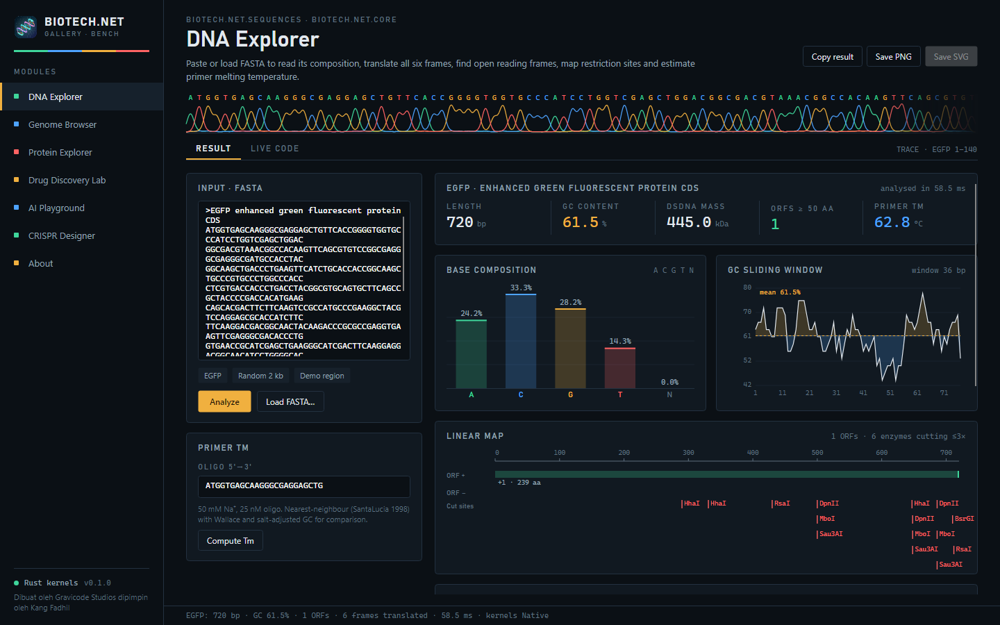
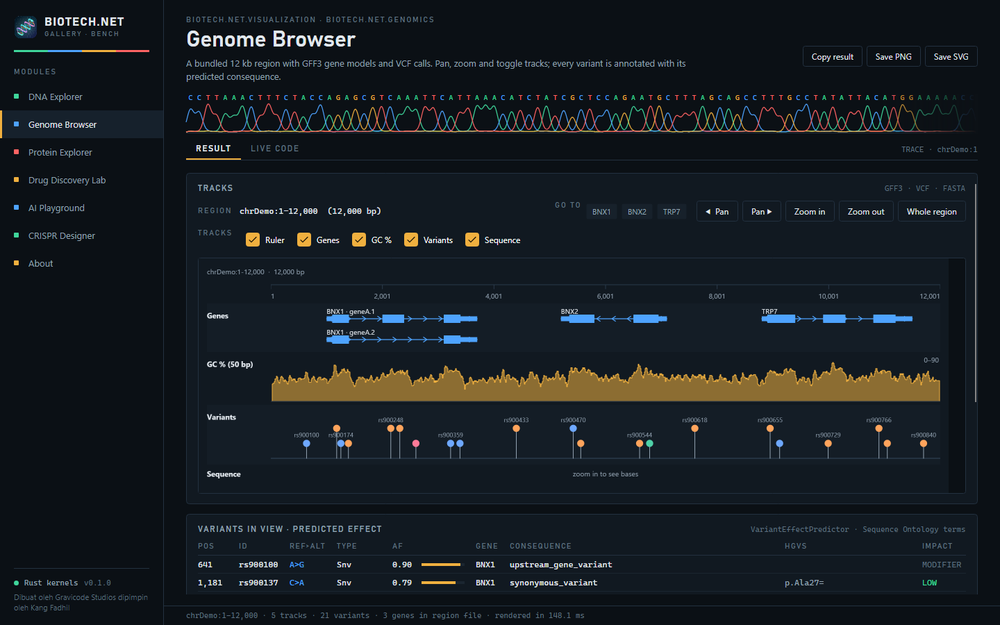
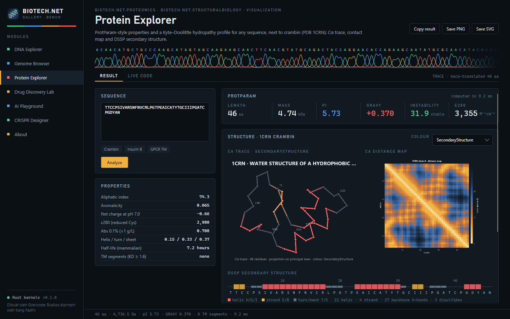
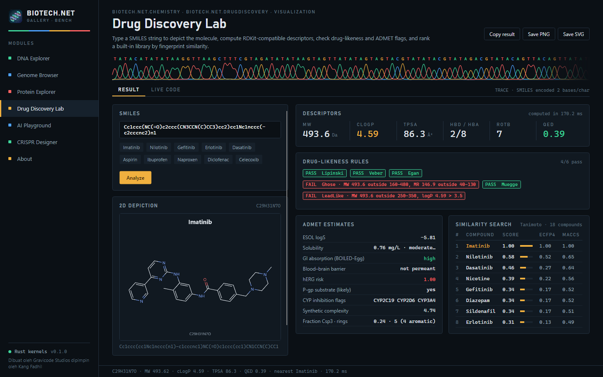
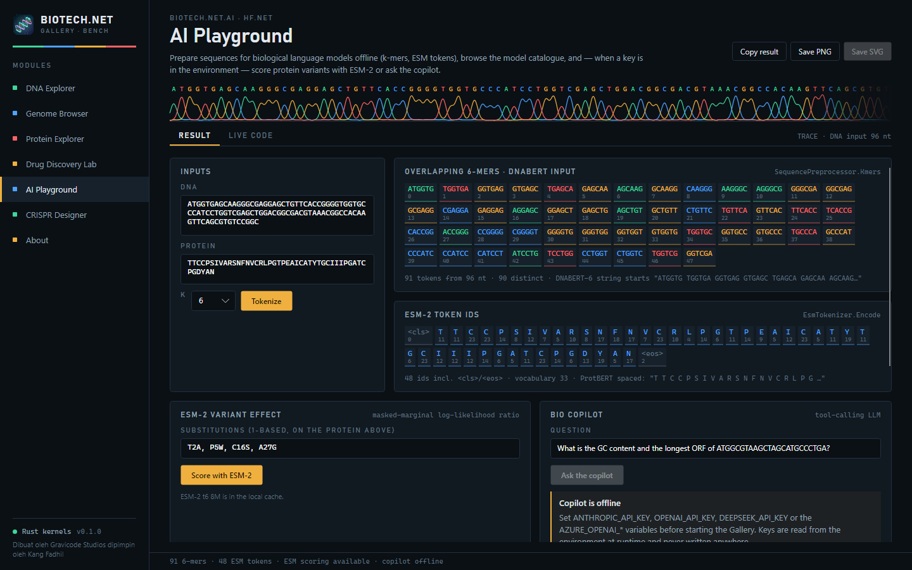
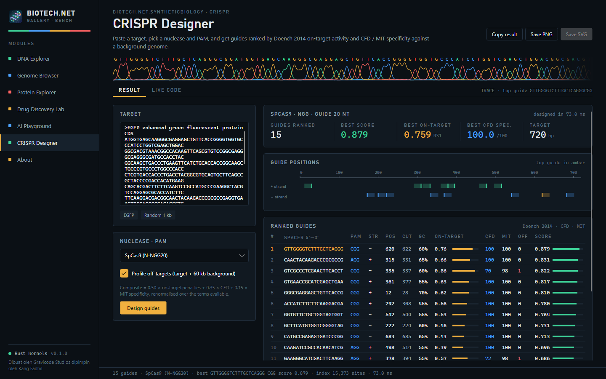
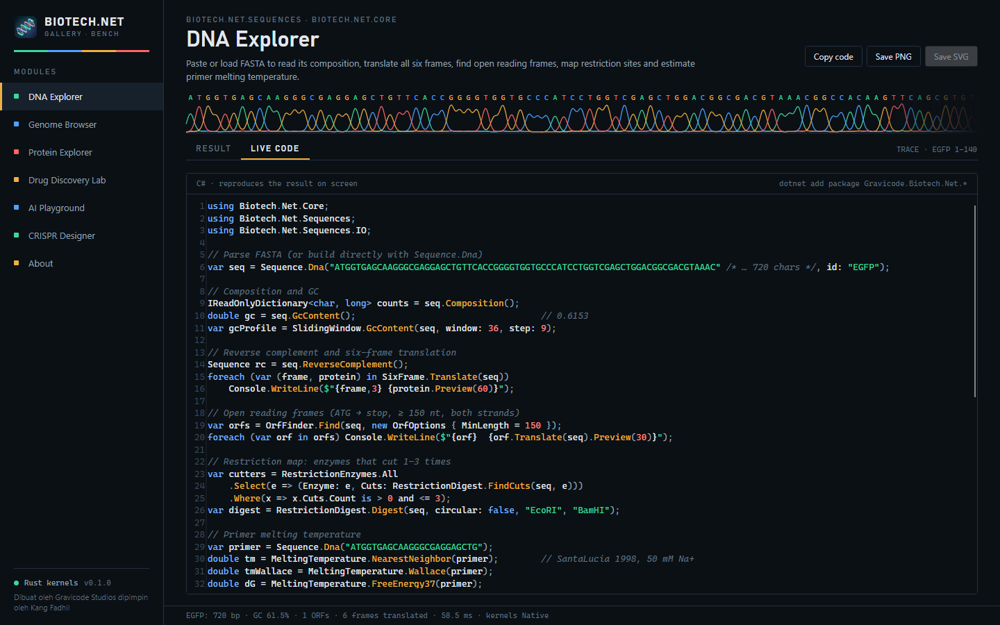
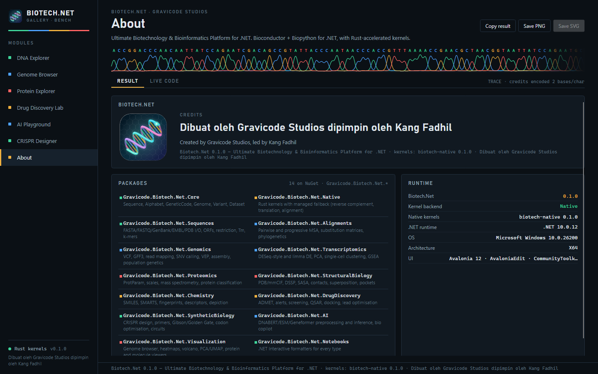

# Samples

> Dibuat oleh Gravicode Studios dipimpin oleh Kang Fadhil

Two ways to see Biotech.Net working: the Avalonia **Gallery** desktop app and the **sample notebooks**.

## Biotech.Net Gallery

A cross-platform Avalonia 12 showcase under `samples/Biotech.Net.Gallery`. Every page runs real library code, shows the C# that produced the result in a *Live code* tab, and can export the figure as PNG or SVG.

```bash
cd samples/Biotech.Net.Gallery
dotnet run -c Release
```

| Page | What it demonstrates | Modules exercised |
|---|---|---|
| **DNA Explorer** | sequence statistics, GC windows, ORFs, restriction digests, translation | Core, Sequences |
| **Genome Browser** | genes, transcripts, coverage, variants and features in one browser view | Core, Genomics, Visualization |
| **Protein Explorer** | ProtParam properties, secondary structure, contacts, Cα trace, 3-D view | Proteomics, StructuralBiology, Visualization |
| **Drug Discovery Lab** | descriptors, drug-likeness rules, ADMET triage, similarity screening | Chemistry, DrugDiscovery |
| **AI Playground** | the model catalogue, preprocessing, embeddings and the LLM copilot | AI |
| **CRISPR Designer** | guide enumeration, on-target scoring and off-target specificity | SyntheticBiology |













The *Live code* tab shows the snippet behind the current result, and the About page carries the credits:





Sample data for the Genome Browser page lives in `samples/Biotech.Net.Gallery/Data` (`region.fa`, `region.gff3`, `region.vcf`).

## Sample notebooks

Six bilingual `.dib` notebooks in `notebooks/`, for Polyglot Notebooks (VS Code), Visual Studio or Jupyter with the .NET kernel:

| Notebook | Contents |
|---|---|
| `01-getting-started.dib` | packages, rich formatters, the core types |
| `02-sequences-and-io.dib` | FASTA/FASTQ/GenBank I/O, ORFs, motifs, restriction digests |
| `03-genome-browser-and-plots.dib` | genome browser, heatmap, sequence logo, static and interactive export |
| `04-rnaseq-differential-expression.dib` | DESeq run, volcano, MA, PCA, clustered heatmap |
| `05-protein-structure.dib` | ProtParam, DSSP, SASA, superposition, 3-D viewer |
| `06-cheminformatics.dib` | SMILES, descriptors, fingerprints, similarity, depiction |

Each starts with `#r "nuget: Gravicode.Biotech.Net.Notebooks, 0.1.0"` and a commented alternative that references the local build instead, so they work both from NuGet and from a clone.

## Figures in this documentation

Every image under `docs/images/` is produced by the library itself — volcano, heatmap, genome browser, sequence logo, molecule depiction, PCA, dot plot, Cα trace and contact map. See the [visualization tutorial](tutorials/visualization.md) for the code.

---
[Documentation index](index.md) · Bahasa Indonesia: [contoh](../id/samples.md)
