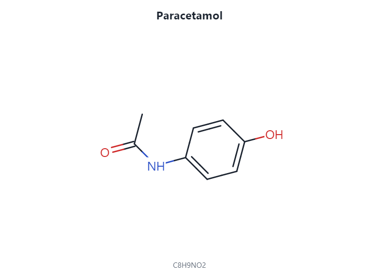

# Tutorial: Cheminformatics

Package: `Gravicode.Biotech.Net.Chemistry`

> Dibuat oleh Gravicode Studios dipimpin oleh Kang Fadhil

SMILES and MOL/SDF input and output, canonical SMILES, aromaticity and ring perception, descriptors (Crippen logP, TPSA, Lipinski and friends, QED), fingerprints (Morgan/ECFP, FCFP, MACCS, path, atom-pair, topological torsion), similarity search, SMARTS substructure search, Murcko scaffolds and 2-D depiction. It is written in pure C#, with no RDKit dependency.

## 1. Molecules and descriptors

```csharp
using Biotech.Net.Chemistry;

var aspirin = Molecule.FromSmiles("CC(=O)Oc1ccccc1C(=O)O", "aspirin");
Console.WriteLine($"{aspirin.Name}: {aspirin.Formula}, {aspirin.AtomCount} heavy atoms");
Console.WriteLine($"canonical SMILES: {aspirin.ToSmiles()}");

DescriptorSet d = MolecularDescriptors.Compute(aspirin);
Console.WriteLine($"MW {d.MolecularWeight:F2}  logP {d.LogP:F2}  TPSA {d.Tpsa:F1}  HBD {d.HBondDonors}  HBA {d.HBondAcceptors}  RotB {d.RotatableBonds}");
Console.WriteLine(DrugLikeness.Lipinski(d));
Console.WriteLine(DrugLikeness.Veber(d));
Console.WriteLine($"QED {Qed.Compute(aspirin):F3}");

Console.WriteLine($"Murcko scaffold: {MurckoScaffold.GetScaffoldSmiles(aspirin)}");
```

## 2. Fingerprints and similarity

```csharp
using Biotech.Net.Chemistry;

var library = new[]
{
    ("aspirin",     "CC(=O)Oc1ccccc1C(=O)O"),
    ("salicylic",   "OC(=O)c1ccccc1O"),
    ("paracetamol", "CC(=O)Nc1ccc(O)cc1"),
    ("ibuprofen",   "CC(C)Cc1ccc(cc1)C(C)C(=O)O"),
    ("caffeine",    "Cn1cnc2c1c(=O)n(C)c(=O)n2C"),
}.Select(x => Molecule.FromSmiles(x.Item2, x.Item1)).ToList();

BitVector ecfp4 = MorganFingerprint.Ecfp4(library[0]);          // radius 2, 2048 bits
BitVector maccs = MaccsKeys.Compute(library[0]);                 // 166 keys
Console.WriteLine($"ECFP4 bits set: {ecfp4.Count}, MACCS keys set: {maccs.Count}");

var index = new FingerprintIndex(m => MorganFingerprint.Ecfp4(m));
index.AddRange(library);
foreach (var hit in index.TopK(library[0], k: 3))
    Console.WriteLine($"{hit.Id,-12} Tanimoto {hit.Score:F3}");

// Other metrics: Dice, Cosine, Tversky, Sokal...
double dice = Similarity.Dice(ecfp4, MorganFingerprint.Ecfp4(library[1]));
```

## 3. Substructure search and file formats

```csharp
using Biotech.Net.Chemistry;

var ibuprofen = Molecule.FromSmiles("CC(C)Cc1ccc(cc1)C(C)C(=O)O", "ibuprofen");
Console.WriteLine(Substructure.HasMatch(ibuprofen, "C(=O)[OH]"));     // carboxylic acid: True
var pattern = SmartsPattern.Parse("c1ccccc1");
Console.WriteLine($"benzene matches: {pattern.CountMatches(ibuprofen)}");

// MOL / SDF round trip (2-D coordinates are generated on demand)
string molBlock = MolFile.Write(ibuprofen);
Molecule back = MolFile.Parse(molBlock);
string sdf = SdfWriter.ToSdf([ibuprofen, back]);
Console.WriteLine($"{SdfReader.Parse(sdf).Count} records in SDF");

// 2-D layout for drawing
Point3[] xy = Depiction.Compute2DCoordinates(ibuprofen);
```

`MoleculeViewer` in `Biotech.Net.Visualization` renders a 2-D depiction to PNG or SVG:



## 4. 3-D conformers and the UFF force field

`ConformerGenerator` embeds molecules in 3-D with an ETKDG-style distance-geometry pipeline (RDKit's ETKDGv3 settings: bounds matrix, 4-D embedding, chirality checks, experimental torsion preferences, planarity terms), then cleans each conformer up with UFF and prunes near-duplicates by symmetry-aware RMSD. Hydrogens are added automatically and the result is reproducible for a given seed.

```csharp
using Biotech.Net.Chemistry;

var ibuprofen = Molecule.FromSmiles("CC(C)Cc1ccc(cc1)[C@@H](C)C(=O)O", "ibuprofen");
ConformerEnsemble ensemble = ConformerGenerator.Generate(ibuprofen, 10, new ConformerOptions { RandomSeed = 42 });
Console.WriteLine($"{ensemble.Count} of {ensemble.Attempted} conformers kept after RMSD pruning");
for (int i = 0; i < ensemble.Count; i++)
    Console.WriteLine($"conformer {i}: UFF energy {ensemble.Energies[i]:F2} kcal/mol");
SdfWriter.WriteFile("ibuprofen_conformers.sdf", ensemble.ToMolecules());   // 3-D SDF with explicit H
double rmsd = ConformerAlignment.BestRmsd(ensemble.Molecule, ensemble.Conformers[0], ensemble.Conformers[1]);
Console.WriteLine($"heavy-atom RMSD between conformers 0 and 1: {rmsd:F2} Å");

// One conformer, then the Universal Force Field directly
Molecule phenol = ConformerGenerator.Embed(Molecule.FromSmiles("Oc1ccccc1", "phenol"));
var uff = UffForceField.Create(phenol);                  // needs explicit hydrogens (Embed adds them)
Console.WriteLine(string.Join(" ", uff.AtomTypes));      // O_R C_R C_R C_R C_R C_R C_R H_ ...
Console.WriteLine(uff.EnergyTerms(phenol.Coordinates!)); // bond, angle, torsion, inversion, vdW
MinimizationResult min = UffForceField.Optimize(phenol); // L-BFGS, in place
Console.WriteLine($"UFF minimum {min.Energy:F3} kcal/mol after {min.Iterations} iterations");
```

Accuracy against RDKit 2026.09.1 (30 molecules, see `tests/Biotech.Net.Chemistry.Tests/Data/conformer_reference_gen.py`):

| Check | Result |
| --- | --- |
| UFF atom types, hybridisation, conjugation | identical on all 30 molecules |
| UFF energy at an RDKit geometry | within 1×10⁻⁴ kcal/mol |
| UFF gradient | within 2×10⁻³ kcal/mol/Å |
| RDKit's UFF minimum | is also a minimum of our field (re-minimising changes E by < 0.01 kcal/mol) |
| Bond lengths vs an RDKit ETKDGv3 conformer | mean deviation 0.015 Å (max 0.10 Å) |
| Bond angles vs an RDKit ETKDGv3 conformer | mean deviation 2.4° (max 25°) |
| Tetrahedral stereo and E/Z | always preserved |
| Coverage of RDKit's ensemble (mean best RMSD) | within 0.13 Å of RDKit's own seed-to-seed coverage (0.07 Å without UFF clean-up) |

Generating ten conformers of a drug-sized molecule takes roughly 0.1–0.9 s on one core; conformers run in parallel by default.

## Limitations

- Conformer generation follows RDKit's ETKDG algorithm but is not bit-identical: 1-5 distance bounds, macrocycle-specific 1-4 bounds, atropisomer and non-tetrahedral stereo, constrained (coordinate-map) embedding and RDKit's newer "all-in-one" minimiser are not implemented, and symmetric torsion-pattern matches may pick different atoms. The UFF clean-up (on by default, `ForceFieldCleanup`) moves conformers slightly away from ETKDG's crystal-like torsions; switch it off to stay closest to RDKit's output.
- Salts and other multi-fragment molecules are embedded fragment by fragment and laid side by side 4 Å apart (RDKit overlays them).
- The force field is UFF, not MMFF94; no electrostatics (RDKit's UFF default). Trigonal-bipyramidal centres and most metal charge states are not parameterised.
- Stereochemistry is parsed and written in SMILES, but the canonical ranking is not guaranteed to match RDKit's canonical SMILES string for string. Compare molecules by fingerprint or canonical SMILES produced by Biotech.Net itself.
- The aromaticity model is RDKit-like. Unusual heteroaromatic systems can be perceived differently from RDKit or Open Babel, which changes fingerprints and SMARTS matches.

---
Previous: [Structural biology](structural-biology.md) · Next: [Drug discovery](drug-discovery.md) · [Tutorial index](index.md)
