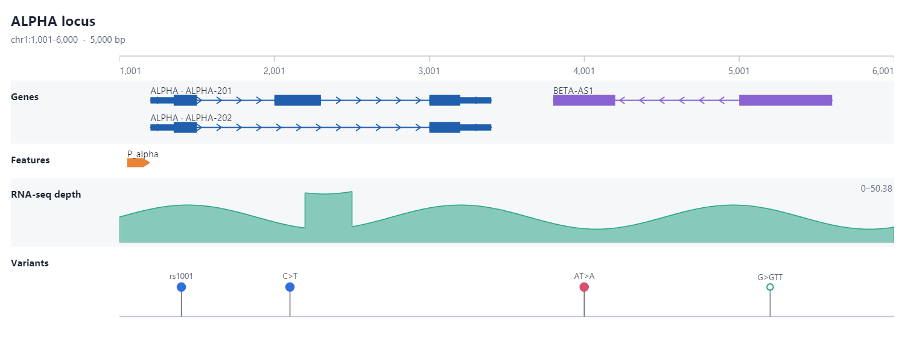

# Tutorial: Genomics

Package: `Gravicode.Biotech.Net.Genomics`

> Dibuat oleh Gravicode Studios dipimpin oleh Kang Fadhil

Variant files (VCF, with tabix), alignment files (SAM, BAM, CRAM), variant-effect prediction, read mapping and SNV calling, de Bruijn assembly, prokaryotic gene finding and population genetics.

Coordinates: `GenomicInterval` is 0-based half-open, and `Variant.Position` is 1-based as in VCF.

## 1. Reading and writing VCF

```csharp
using Biotech.Net.Core;
using Biotech.Net.Genomics.Vcf;

string vcf = """
##fileformat=VCFv4.2
##contig=<ID=chr1,length=10000>
##FORMAT=<ID=GT,Number=1,Type=String,Description="Genotype">
#CHROM	POS	ID	REF	ALT	QUAL	FILTER	INFO	FORMAT	S1	S2	S3
chr1	101	rs1	A	G	50	PASS	DP=30	GT	0/1	1/1	0/0
chr1	250	.	C	T	12	LowQual	DP=8	GT	0/0	0/1	./.
chr1	400	rs3	AT	A	70	PASS	DP=41	GT	0/1	0/1	1/1
""".Replace("\r", "");

var (header, records) = VcfReader.Parse(vcf);
Console.WriteLine($"{header.Samples.Count} samples, {records.Count} records");
foreach (var r in records.PassOnly())
    Console.WriteLine($"{r.Variant} {r.Variant.Type} AF={r.Variant.AlternateAlleleFrequency():F2} GT(S1)={r.GetGenotype(0)}");

// Write back (VcfWriter.Create with a ".gz" path writes BGZF, which tabix can index; see section 6)
var sw = new StringWriter();
using (var writer = new VcfWriter(sw, header, leaveOpen: true)) writer.Write(records);
```

For files on disk, `VcfReader.Open(path)` streams records, and `reader.Query(GenomicInterval)` filters them by region (through the tabix index when the file is a `.vcf.gz` with a `.tbi` or `.csi`).

## 2. Variant-effect prediction

`VariantEffectPredictor` assigns Sequence Ontology consequences and HGVS notation using the genes and transcripts of a `Genome`. Genes can come from GFF3 (`GffReader.LoadGenes`) or be built in code:

```csharp
using Biotech.Net.Core;
using Biotech.Net.Genomics.Annotation;

// A one-exon gene: ATG AAA CGC ... TAA on chr1 positions 10..39 (0-based)
var chrSeq = Sequence.Dna("GGGGGGGGGG" + "ATGAAACGCATTAGCACCACCATTACCTAA" + "GGGGGGGGGG", "chr1");
var genome = new Genome("toy").Add(Chromosome.FromSequence(chrSeq));
var gene = new Gene("G1", new GenomicInterval("chr1", 10, 40, Strand.Forward), "TOY1");
gene.Transcripts.Add(new Transcript("TOY1-201", "G1", [new GenomicInterval("chr1", 10, 40, Strand.Forward)])
    { CodingRegion = new GenomicInterval("chr1", 10, 40, Strand.Forward) });
genome.Add(gene);

var vep = new VariantEffectPredictor(genome);
// Position 17 (1-based) is the first base of codon 3 (CGC, Arg); C>T gives TGC (Cys)
foreach (var effect in vep.Predict("chr1", 17, "C", "T"))
    Console.WriteLine($"{effect.ConsequenceTerms} {effect.Impact} {effect.HgvsC} {effect.HgvsP}");
```

## 3. Mapping reads and calling SNVs

```csharp
using Biotech.Net.Core;
using Biotech.Net.Genomics.Calling;
using Biotech.Net.Genomics.Mapping;
using Biotech.Net.Sequences;

var reference = RandomSequence.Dna(2_000, seed: 5, id: "ref");
// Simulate a homozygous A/C/G/T change at 0-based position 1000
var sample = reference.ToString().ToCharArray();
sample[1000] = sample[1000] == 'A' ? 'G' : 'A';
var sampleSeq = new string(sample);

var rng = new Random(9);
var reads = Enumerable.Range(0, 400).Select(i =>
{
    int start = rng.Next(0, sampleSeq.Length - 100);
    return SequenceRead.FromAscii($"r{i}", sampleSeq.Substring(start, 100), new string('I', 100));
}).ToList();

var mapper = new ReadMapper([reference]);
var alignments = mapper.Map(reads).ToList();
Console.WriteLine($"mapped {alignments.Count(a => a.IsMapped)}/{alignments.Count}");

var calls = SnvCaller.Call([reference], alignments);
foreach (var call in calls) Console.WriteLine(call);
```

`SamWriter` writes the alignments as SAM, and `SamReader` reads SAM produced by other tools. To keep them as an indexed BAM, convert with `ToAlignmentRecord(header)`, sort with `CoordinateComparer.Sort` and write with `BamWriter` (section 6); `Pileup.AddRange` also accepts records read back from BAM or CRAM.

## 4. Assembly and gene finding

```csharp
using Biotech.Net.Core;
using Biotech.Net.Genomics.Assembly;
using Biotech.Net.Genomics.GeneFinding;
using Biotech.Net.Sequences;

var target = RandomSequence.Dna(3_000, seed: 11, id: "target");
var rng = new Random(4);
var reads = Enumerable.Range(0, 600)
    .Select(i => target.Subsequence(rng.Next(0, target.Length - 120), 120).WithId($"r{i}"))
    .ToList();

var assembly = DeBruijnAssembler.Assemble(reads, new AssemblyOptions { K = 31, MinKmerCount = 2 });
Console.WriteLine(assembly.Stats);

// Self-training prokaryotic gene finder (Markov coding model + RBS scoring)
var finder = new ProkaryoticGeneFinder();
foreach (var g in finder.Predict(target).Take(5)) Console.WriteLine(g);
```

## 5. Population genetics

```csharp
using Biotech.Net.Core;
using Biotech.Net.Genomics.Population;

var v = new Variant("chr1", 100, "A", "G");
foreach (var gt in new[] { "0/0", "0/1", "0/1", "1/1", "0/0", "0/1" }) v.Genotypes.Add(Genotype.Parse(gt));

var counts = GenotypeCounts.From(v);
Console.WriteLine($"AF {counts.AlternateFrequency:F2}, Hobs {counts.ObservedHeterozygosity:F2}, HWE p {counts.HardyWeinbergP():F3}");

// Tajima's D from a site frequency spectrum, Hudson Fst from allele counts
long[] sfs = SiteFrequencySpectrum.Unfolded([1, 1, 2, 5, 1, 3, 1], sampleSize: 10);
Console.WriteLine($"Tajima's D {SiteFrequencySpectrum.TajimasD(sfs):F3}");
double fst = Fst.Hudson([(Ac1: 2, An1: 20, Ac2: 15, An2: 20), (Ac1: 5, An1: 20, Ac2: 6, An2: 20)]);
```

The genome browser in `Biotech.Net.Visualization` draws genes, coverage and variants together:



## 6. BAM, CRAM and tabix

BAM and CRAM records are read into `AlignmentRecord` (0-based `Position`, typed optional fields). Region strings follow samtools (`chr1:1001-1100`, 1-based inclusive); the `Query(name, start, end)` overloads take 0-based half-open coordinates.

```csharp
using Biotech.Net.Genomics.IO;
using Biotech.Net.Genomics.Mapping;

var header = SamHeader.Create([("chr1", 10_000L)], sortOrder: "coordinate");
var rng = new Random(1);
var records = new List<AlignmentRecord>();
for (int i = 0; i < 200; i++)
{
    string seq = string.Concat(Enumerable.Range(0, 50).Select(_ => "ACGT"[rng.Next(4)]));
    records.Add(AlignmentRecord.Parse(
        $"read{i}\t0\tchr1\t{1 + rng.Next(9_900)}\t60\t50M\t*\t0\t0\t{seq}\t{new string('I', 50)}\tNM:i:0", header));
}

// Coordinate-sort, write BGZF-compressed BAM and build the .bai on the fly
using (var writer = BamWriter.Create("demo.bam", header, new BamWriterOptions { Index = BinningIndexFormat.Bai }))
    writer.Write(CoordinateComparer.Sort(records));

using var bam = BamReader.Open("demo.bam");                  // loads demo.bam.bai
foreach (var r in bam.Query("chr1:1001-1100"))               // samtools-style region, 1-based
    Console.WriteLine($"{r.Name} {r.ReferenceName}:{r.Position + 1} {Cigar.Format(r.Cigar)} NM={r.GetInt("NM")}");

int[] depth = AlignmentDepth.Compute(bam, "chr1", 1000, 1100); // 0-based half-open, like samtools depth -a
Console.WriteLine($"mean depth {depth.Average():F1}");
```

CRAM needs the reference FASTA (with or without a `.fai`; one is built in memory if missing). Sequences, MD/NM tags, mate fields and template lengths are reconstructed as `samtools view` does:

```csharp
using Biotech.Net.Genomics.Cram;

using var cram = CramReader.Open("sample.cram", "reference.fa"); // also loads sample.cram.crai
Console.WriteLine($"CRAM {cram.MajorVersion}.{cram.MinorVersion}, {cram.Header.References.Count} references");
foreach (var r in cram.Query("chr1:500-1500").Take(3))
    Console.WriteLine($"{r.Name} {r.Flags} {r.ReferenceName}:{r.Position + 1} MAPQ {r.MapQ} MD={r.GetString("MD")}");
```

`AlignmentFile.Open(path, referencePath)` picks SAM, BAM or CRAM from the file content.

Tabix indexes any position-sorted, BGZF-compressed text file:

```csharp
using Biotech.Net.Genomics.IO;
using Biotech.Net.Genomics.Vcf;

// bgzip-compress a VCF (a ".gz" path is written as BGZF) and index it
using (var reader = VcfReader.Open("calls.vcf"))
using (var writer = VcfWriter.Create("calls.vcf.gz", reader.Header))
    foreach (var rec in reader.Records()) writer.Write(rec);
TabixIndex.Build("calls.vcf.gz", TabixConfig.VcfPreset).Save("calls.vcf.gz.tbi");

using var vcf = VcfReader.Open("calls.vcf.gz");               // finds calls.vcf.gz.tbi
Console.WriteLine($"indexed: {vcf.IsIndexed}");
foreach (var rec in vcf.Query("chr1:5000-5100"))
    Console.WriteLine(rec.Variant);

// any bgzipped, tabix-indexed text file (BED, GFF, ...)
using var bed = TabixReader.Open("features.bed.gz");
foreach (string line in bed.Query("chr2:1-200"))
    Console.WriteLine(line);
```

Indexes written here (`.bai`, `.csi`, `.tbi`) contain the same bins and chunks as those from `samtools index` and `tabix`, and samtools reads the BAM files `BamWriter` produces.

## Limitations

- CRAM is read-only (no CRAM writer), and CRAM blocks compressed with LZMA raise `NotSupportedException`; re-encode such files with samtools (without `use_lzma`). BAM, BGZF, BAI/CSI and tabix are both read and written.
- `IndexedFastaReader` (and so the CRAM reference) needs an uncompressed FASTA; bgzipped FASTA with `.gzi` is not supported.
- `ReadMapper` is for short reads against small and mid-size references held in memory, for example bacterial genomes and amplicons. It is not a BWA or minimap2 replacement for whole human genomes.
- `SnvCaller` is a diploid SNV caller only; it does not call indels or do local reassembly.
- The de Bruijn assembler suits error-light short reads on small genomes. It does no scaffolding and does not use paired-end information.

---
Previous: [Alignments](alignments.md) · Next: [Transcriptomics](transcriptomics.md) · [Tutorial index](index.md)
