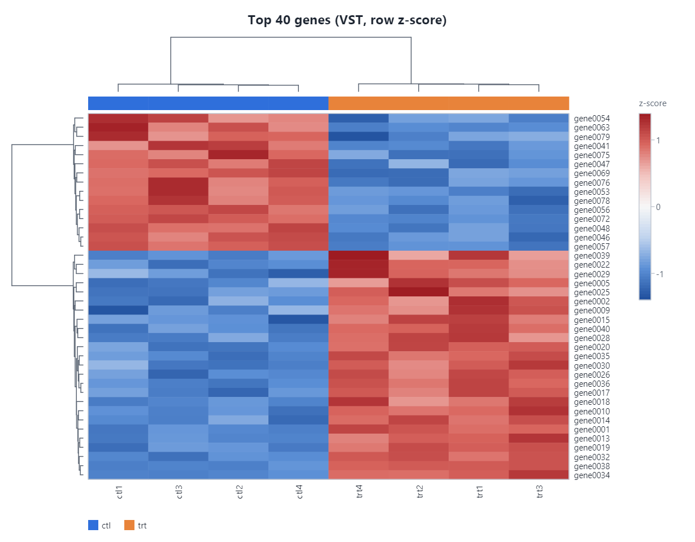
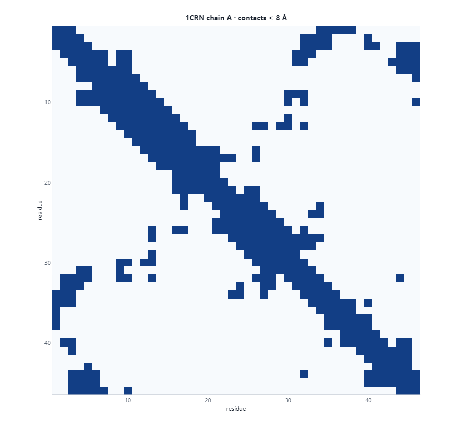

# Tutorial: Visualization

Package: `Gravicode.Biotech.Net.Visualization` (built on Visual.Net / Matplotlib.Net / Plotly.Net and SkiaSharp)

> Dibuat oleh Gravicode Studios dipimpin oleh Kang Fadhil

Genome browser, heatmap with dendrograms, volcano and MA plots, PCA/UMAP embeddings, sequence logos, dot plots, protein Cα traces and contact maps, 2-D molecule depiction, and interactive 3-D views through 3Dmol.js.

Every plot derives from `BioPlot` and exports the same way:

| Method | Output |
|---|---|
| `ToPng(scale)` | PNG bytes (`scale` for high-DPI) |
| `ToSvg()` | SVG text |
| `ToPdf()` | PDF bytes |
| `ToHtml(interactive)` | HTML — Plotly where `SupportsInteractive` is true, otherwise an embedded image |
| `Save(path)` | writes the format implied by the extension (`.png`, `.svg`, `.pdf`, `.html`) |
| `ToPngDataUri()` | `data:image/png;base64,...` for notebooks and web pages |

All of it is headless and cross-platform: no display server is needed.

## 1. Themes

```csharp
using Biotech.Net.Visualization;

BioTheme.Default = BioTheme.Light;        // or BioTheme.Dark
var custom = BioTheme.Light.With(t => t with { Name = "lab", FontFamily = "Inter", FontSize = 13 });
Console.WriteLine($"{custom.Name}: {custom.Palette.Count} categorical colours, nucleotide A = {custom.NucleotideColor('A')}");
```

A theme carries the categorical palette, up/down/neutral colours, per-nucleotide and per-residue colours, element colours for molecules, fonts and the colormaps used by heatmaps.

## 2. Expression plots

```csharp
using Biotech.Net.Core;
using Biotech.Net.Transcriptomics;
using Biotech.Net.Visualization;

var rng = new Random(42);
int genes = 1200, samples = 8;
var values = new double[genes * samples];
for (int g = 0; g < genes; g++)
{
    double mean = Math.Exp(2 + rng.NextDouble() * 6);
    double fold = g < 40 ? 4 : g < 80 ? 0.25 : 1;
    for (int s = 0; s < samples; s++)
        values[g * samples + s] = Math.Round(mean * (s >= 4 ? fold : 1)
            * Math.Exp(0.25 * (rng.NextDouble() + rng.NextDouble() + rng.NextDouble() - 1.5)));
}
var counts = new Dataset("counts",
    Enumerable.Range(1, genes).Select(i => $"gene{i:D4}").ToArray(),
    ["ctl1", "ctl2", "ctl3", "ctl4", "trt1", "trt2", "trt3", "trt4"], values);
counts.Annotate("condition", "ctl", "ctl", "ctl", "ctl", "trt", "trt", "trt", "trt");
var result = DESeq.Run(counts, "condition", "ctl", "trt");

var volcano = new VolcanoPlot(result) { Title = "Treated vs control", LabelTop = 8, FoldChangeThreshold = 1 };
File.WriteAllBytes(Path.Combine(Path.GetTempPath(), "volcano.png"), volcano.ToPng(scale: 1.5));
Console.WriteLine(volcano.Counts());        // (Up, Down, NotSignificant)

var ma = new MaPlot(result);

// Clustered heatmap of the top genes (row z-scores, average linkage)
var vst = Transforms.Vst(counts);
var top = result.Top(40).Select(r => vst.RowIndex(r.Gene)).ToArray();
var heat = Heatmap.FromDataset(vst.SelectRows(top, "Top 40 genes"));
heat.ColumnGroups = counts.ColumnAnnotations["condition"];
Console.WriteLine($"{heat.Rows}×{heat.Columns} heatmap, clustering rows: {heat.ClusterRows}");
```




## 3. Genome browser

Tracks are added fluently and the browser measures its own height.

```csharp
using Biotech.Net.Core;
using Biotech.Net.Visualization;

var region = GenomicInterval.Parse("chr1:1,001-6,000");
var gene = new Gene("G1", new GenomicInterval("chr1", 1200, 3400, Strand.Forward), "ALPHA");
gene.Transcripts.Add(new Transcript("ALPHA-201", "G1",
    [new("chr1", 1200, 1500, Strand.Forward), new("chr1", 2000, 2300, Strand.Forward), new("chr1", 3000, 3400, Strand.Forward)])
    { CodingRegion = new GenomicInterval("chr1", 1350, 3200, Strand.Forward) });

double[] depth = Enumerable.Range(0, 5000).Select(i => 25 + 12 * Math.Sin(i / 280.0)).ToArray();
var variants = new[] { new Variant("chr1", 1400, "A", "G", "rs1001"), new Variant("chr1", 4000, "AT", "A") };

var browser = new GenomeBrowser(region, width: 1000) { Title = "ALPHA locus" }
    .AddRuler()
    .AddGenes([gene])
    .AddCoverage(depth, start: 1000, name: "RNA-seq depth")
    .AddVariants(variants);
Console.WriteLine($"{browser.Tracks.Count} tracks, {browser.Height} px tall, {browser.BasesPerPixel:F1} bp/px");
```


Available tracks: `RulerTrack`, `GeneTrack`, `FeatureTrack`, `CoverageTrack`, `VariantTrack` and `SequenceTrack` (letters at base-level zoom). Derive from `GenomeTrack` for your own.

## 4. Sequences, structures and molecules

```csharp
using Biotech.Net.Chemistry;
using Biotech.Net.StructuralBiology;
using Biotech.Net.Visualization;

string[] sites =
[
    "TAATGTGAGTTAGCTCACTCAT", "TAATGTGAGTTAGCACACTCAT", "TGATGTGAGTTAGCTCACTCAT",
    "TAATGTGAGTTAGCTCACTCTT", "TAATGCGAGTTAGCTCACTCAT", "TAATGTGAGCTAGCTCACTCAT",
];
var logo = new SequenceLogo(sites) { Title = "CRP-like site" };
Console.WriteLine($"{logo.Length} columns, max {logo.MaxBits:F0} bits");

var crambin = SampleStructures.Crambin();
var trace = ProteinViewer.CaTrace(crambin);
var contacts = ProteinViewer.ContactMap(crambin);
string html3d = ProteinViewer.To3DHtml(crambin, new Viewer3DOptions { Style = MolecularStyle.Cartoon, Spin = true });

var viewer = new MoleculeViewer(Molecule.FromSmiles("CC(=O)Nc1ccc(O)cc1", "paracetamol"), 520, 380);
Console.WriteLine($"{viewer.Coordinates2D().Length} atom positions laid out");
```




## Limitations

- 3-D protein and molecule views are HTML pages that load 3Dmol.js from a CDN, so they need a browser and network access. Static output (Cα trace, contact map, 2-D depiction) is rendered locally with no network.
- Interactive Plotly output exists only for plots where `SupportsInteractive` is true (volcano, MA, embedding, heatmap, contact map, dot plot). The genome browser, sequence logo, Cα trace and molecule viewer export as images or HTML with an embedded image.
- Heatmap clustering is in-memory hierarchical clustering; tens of thousands of rows will be slow and unreadable. Filter to the genes you care about first.
- On Linux, SkiaSharp needs the native asset package; `Gravicode.Biotech.Net.Visualization` already depends on `SkiaSharp.NativeAssets.Linux.NoDependencies`.

---
Previous: [AI](ai.md) · Next: [Notebooks](notebooks.md) · [Tutorial index](index.md)
