# Web Gallery and C# Playground

> Dibuat oleh Gravicode Studios dipimpin oleh Kang Fadhil

`samples/Biotech.Net.WebGallery` is a Blazor WebAssembly (standalone) app: the browser twin of the [desktop Gallery](samples.md), with the same pages, data and "bench instrument" design, plus a **C# Playground** that compiles and runs Biotech.Net snippets inside the browser tab. All computation runs client-side on the Biotech.Net libraries. There is no server and nothing is uploaded.

Live: [https://dotnetvibecoderz.github.io/Vibe_Bio/](https://dotnetvibecoderz.github.io/Vibe_Bio/) (deployed by `.github/workflows/biotechnet-webgallery.yml` on every push to `main` that touches the app or the libraries).

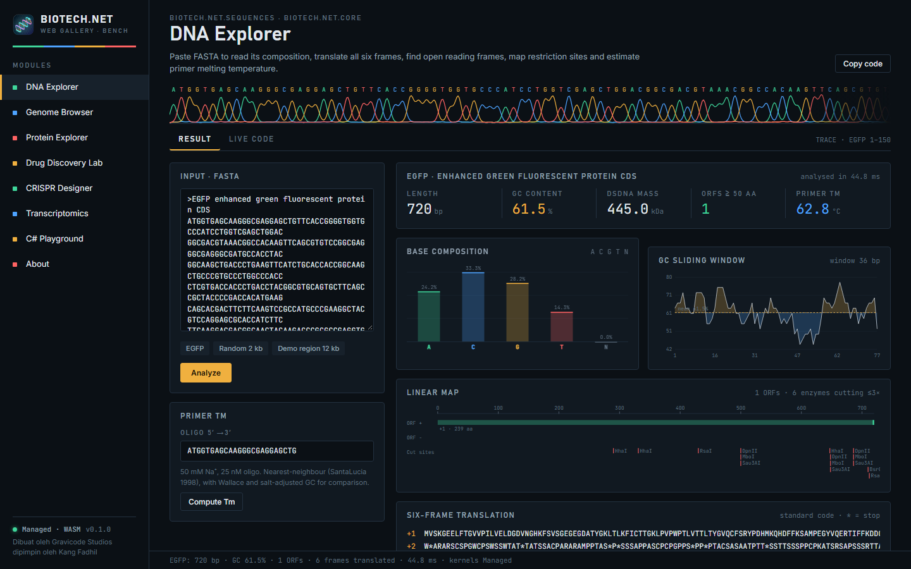

## Pages

| Page | What it does | Modules |
|---|---|---|
| **DNA Explorer** | composition, GC window, six-frame translation, ORFs, restriction map, primer Tm | Core, Sequences |
| **Genome Browser** | the bundled 12 kb region (FASTA + GFF3 + VCF): pan, zoom, toggle tracks, predicted variant effects; the figure is a `GenomeBrowser` SVG | Genomics, Visualization |
| **Protein Explorer** | ProtParam, Kyte–Doolittle profile, TM segments; crambin (1CRN, bundled in the library) in 3Dmol.js, Cα trace, contact map, DSSP | Proteomics, StructuralBiology, Visualization |
| **Drug Discovery Lab** | SMILES → descriptors, drug-likeness rules (Lipinski and others), ADMET flags, alerts, 2-D depiction (SVG), ECFP4 + MACCS similarity against 18 approved drugs | Chemistry, DrugDiscovery, Visualization |
| **CRISPR Designer** | guides on a pasted target for any nuclease, Rule Set 1 on-target score, CFD / MIT specificity against a 60 kb background | SyntheticBiology |
| **Transcriptomics** | a bundled count table (`wwwroot/data/ifn-demo-counts.tsv`, 400 genes × 6 samples, synthetic demo data) through `DESeq.Run`, with volcano and MA plots | Transcriptomics, Visualization |
| **C# Playground** | edit and run snippets; ten examples taken from the tutorials | all of the above |
| **About** | credits, packages, runtime, what works in the browser | Core |

Every page except the Playground has a **Live code** tab with C# that reproduces the result. **Open in Playground** loads that code into the editor, where it runs as is.

## Run it locally

```bash
dotnet workload install wasm-tools      # once; see "Figures and the wasm-tools workload" below
cd samples/Biotech.Net.WebGallery
dotnet run                              # dev server, http://localhost:5xxx
```

To serve a release build the way Pages will:

```bash
dotnet publish samples/Biotech.Net.WebGallery -c Release -p:SkipRustBuild=true -o publish
cd publish/wwwroot && python -m http.server 8080      # any static file server works
```

`python -m http.server` has no SPA fallback, so start from `http://localhost:8080/` and navigate inside the app. A deep link such as `/playground` needs a server that returns `index.html` for unknown paths, which `404.html` does on Pages.

### Figures and the wasm-tools workload

Every library figure is SVG. The SVG writer (Matplotlib.Net) measures text with SkiaSharp, so SkiaSharp's native library has to be linked into the WebAssembly runtime (`dotnet.native.wasm`). That requires the `wasm-tools` workload. The project references `SkiaSharp.NativeAssets.WebAssembly` only when the workload is installed:

- **With wasm-tools:** figures render. Publishing takes a few minutes because the runtime is re-linked with emscripten.
- **Without it:** the app still builds and runs. This is the case for a plain `dotnet build Biotech.Net.slnx`, so CI does not need the workload. Pages that draw library figures show a notice in their place, and everything else works.
- `-p:BiotechWasmSkia=false` opts out explicitly.

## What works in the browser, and what does not

| | Status |
|---|---|
| Sequences, alignment, VCF/GFF3, variant effects, DESeq2-style tests, ProtParam, DSSP, SASA, SMILES, descriptors, ADMET, fingerprints, CRISPR design, codon optimisation | run in the browser |
| SVG figures (genome browser, volcano, MA, Cα trace, contact map, molecule depiction) | run (needs the wasm-tools publish described above) |
| Rust kernels | **not loaded**: native code cannot run in WebAssembly. The probe in `Biotech.Net.Native` fails quietly and every kernel uses its managed C# version (About and the status line show `kernels Managed`). Results are identical, but large inputs run slower. |
| Threads | the browser runtime has one thread. `Parallel.For` runs sequentially, and a long computation keeps the page busy until it finishes. |
| 3-D viewers | load 3Dmol.js 2.4.2 from jsDelivr inside a sandboxed iframe, so they need a network connection |
| AI module (Hugging Face downloads, local inference, LLM copilot), GPU kernels, cloud data clients, workflow engines, file paths | **not available** in the browser; use the desktop Gallery or a notebook |

## Playground

- **Editor:** a plain monospaced text area. Tab indents and Ctrl+Enter (Cmd+Enter on macOS) runs. Snippets are top-level statements. `System`, `System.Linq`, `System.Collections.Generic`, `System.IO`, `System.Text`, `System.Threading.Tasks` and `Biotech.Net.Core` are imported for you, along with `Show(...)`.
- **`Show(x)`** renders `x` under the console output:
  - a `BioPlot` becomes inline SVG;
  - a `Structure` opens a 3Dmol.js viewer;
  - a `Molecule` is depicted;
  - an SVG string is shown as-is;
  - anything else is printed.
- **Presets** (from `docs/en/tutorials`): sequences, pairwise alignment, MSA and a neighbour-joining tree, ProtParam, crambin structure analysis (with a 3-D view), aspirin descriptors (with a depiction), ADMET and PAINS, codon optimisation, variant effects, and DESeq with a volcano plot.

### How it works

1. **Load the compiler.** Opening the Playground lazy-loads Roslyn (`Microsoft.CodeAnalysis` and `Microsoft.CodeAnalysis.CSharp`, 2.7 MB Brotli). No other page downloads it.
2. **Build references from memory.** The references come from the assemblies already loaded in the WebAssembly runtime, read from memory with `AssemblyExtensions.TryGetRawMetadata`. No reference assemblies are downloaded. That is 52 assemblies: the trimmed framework plus every Biotech.Net module.
3. **Compile and run.** Each run is compiled in memory with `concurrentBuild: false` and loaded with `Assembly.Load(byte[])`. The entry point is invoked while `Console.Out` is redirected.
4. **Speed.** Warm-up takes about 1 s. After that a typical snippet compiles in 60–700 ms and runs in milliseconds.

### Limitations

- **Missing framework members.** The framework is trimmed. The app keeps `System.Runtime`, `System.Linq`, `System.Collections` and `System.Console` whole, plus a list of common `System.Private.CoreLib` types (`Playground/TrimmerRoots.xml`: strings, math, spans, collections, tasks, interpolated strings and so on). A snippet that uses some other framework member the gallery never calls can fail to compile with "does not contain a definition". The Biotech.Net assemblies are not trimmed.
- **Long runs freeze the page.** Snippets run on the UI thread, so an infinite loop freezes the tab and only a reload stops it.
- **No NuGet references.** Snippets cannot add NuGet packages. Only the assemblies the app ships are available.
- **Plain editor.** The editor has no IntelliSense. Compiler errors are listed with line and column.

## Download size

These are the numbers measured for the Release publish, with the wasm-tools build:

| | Size |
|---|---|
| `wwwroot` on disk (every file plus its `.br` and `.gz` copies) | 63 MB |
| `_framework` uncompressed | 31.4 MB (120 files) |
| `_framework` Brotli | 9.5 MB, of which Roslyn (lazy, Playground only) is 2.7 MB |
| First visit (Brotli, without Roslyn) | about 6.8 MB |

**What makes up the size:**

- **Trimming.** The publish uses `TrimMode=partial`: the framework is trimmed and the Biotech.Net libraries are kept whole, because snippets compile against them.
- **The runtime.** The largest single item is `dotnet.native.wasm` (5.6 MB raw), which includes Skia.
- **Unused dependencies.** ILGPU and Parquet come in through the `Gravicode.Science` packages, are never used in the browser, and are marked trimmable.

**Compression on GitHub Pages.** Pages does not serve the precompressed `.br` files, so the Pages workflow deletes them. Pages compresses responses itself with gzip; the gzip copies total 13 MB including Roslyn.

## Deploy to GitHub Pages

The workflow is kept at `build/workflows/biotechnet-webgallery.yml`. It does nothing until it is copied to the monorepo root `.github/workflows/`. It:

1. installs .NET 10 and the `wasm-tools` workload;
2. runs `dotnet publish samples/Biotech.Net.WebGallery -c Release -p:SkipRustBuild=true`;
3. rewrites `<base href="/" />` to `/<repository>/`, which is `/Vibe_Bio/` here;
4. copies `index.html` to `404.html`, so deep links reach the Blazor router;
5. adds `.nojekyll`, so `_framework/` is served;
6. deletes the `.br` and `.gz` files;
7. uploads the folder with `actions/upload-pages-artifact` and deploys it with `actions/deploy-pages`.

**Repository settings:**

- **Pages source.** Settings → Pages → Build and deployment → Source: **GitHub Actions**.
- **Environment.** The `github-pages` environment, which GitHub creates on the first deployment, must allow the `main` branch. That is the default rule.
- **Publicity.** The site is public as soon as it is deployed.

## Files

| Path | What it is |
|---|---|
| `samples/Biotech.Net.WebGallery/Pages/*.razor` | one component per page |
| `Shared/PageFrame.razor` | header, chromatogram ribbon, Result / Live code tabs, status line |
| `Services/Bench.cs` | design tokens, plot theme, safe SVG embedding, chromatogram |
| `Services/Charts.cs` | small inline-SVG instruments (bars, profile, linear map) |
| `Playground/SnippetCompiler.cs` | Roslyn compile and run |
| `Playground/Presets.cs` | the ten examples |
| `Playground/Display.cs` | `Show(...)` |
| `wwwroot/css/app.css` | the chassis styles |
| `../Biotech.Net.Gallery/Data/*` | the Genome Browser region, shared with the desktop Gallery as embedded resources |

## Screenshots

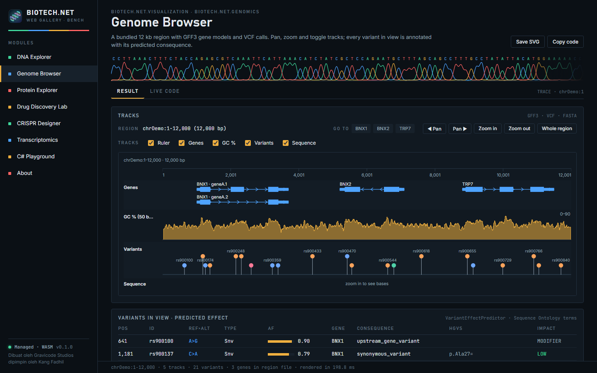

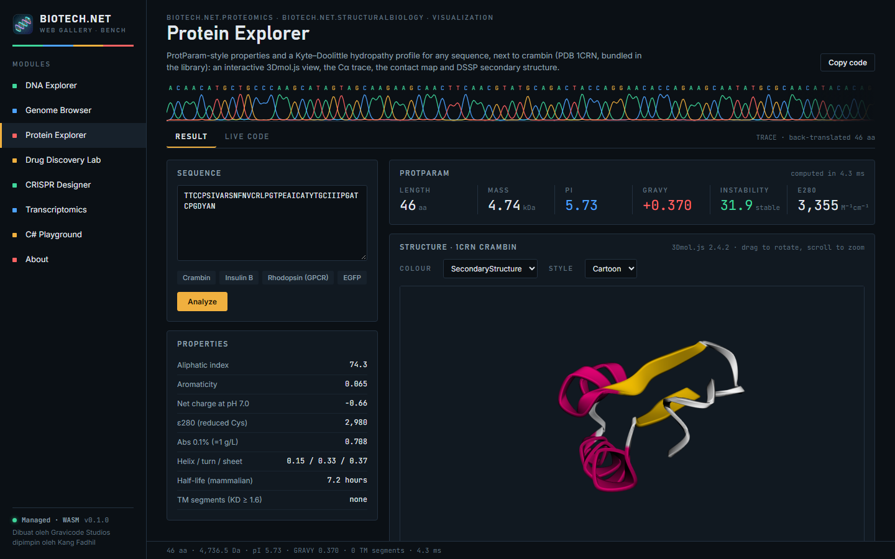

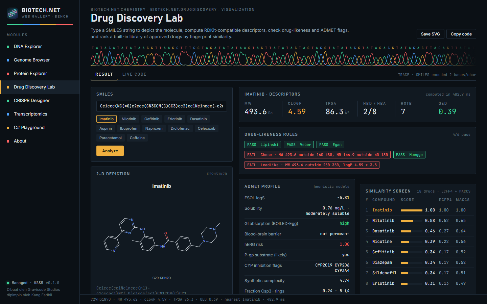

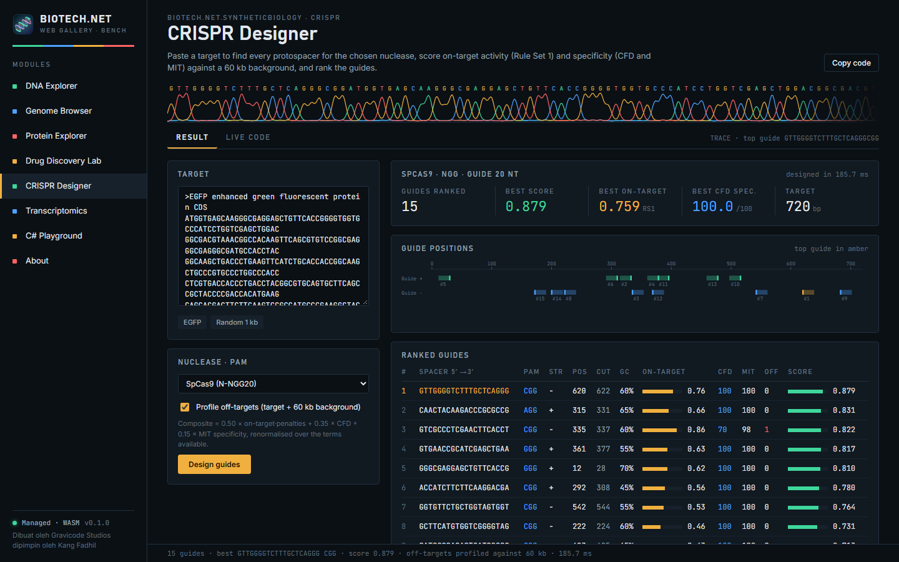

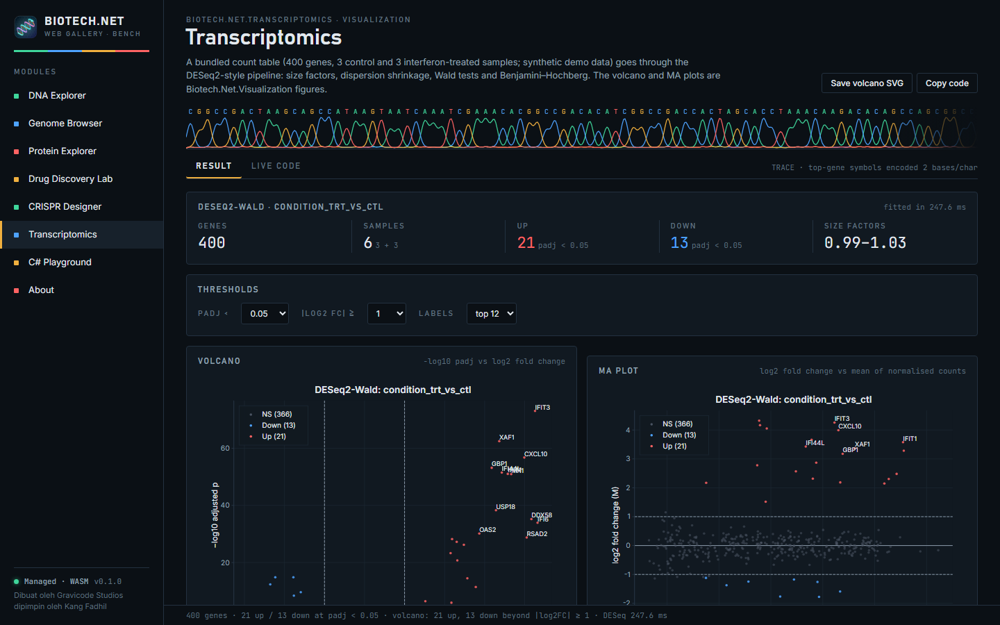

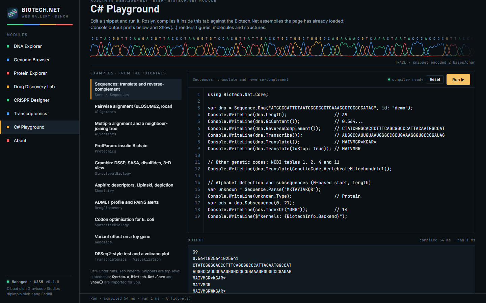

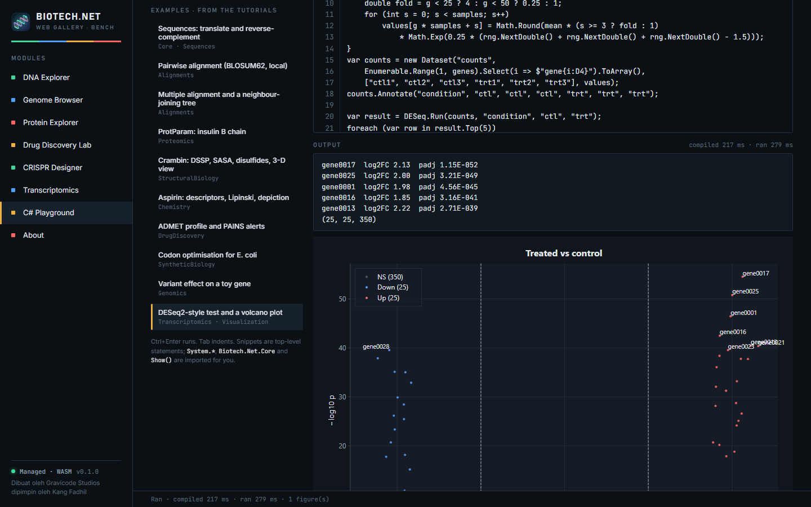

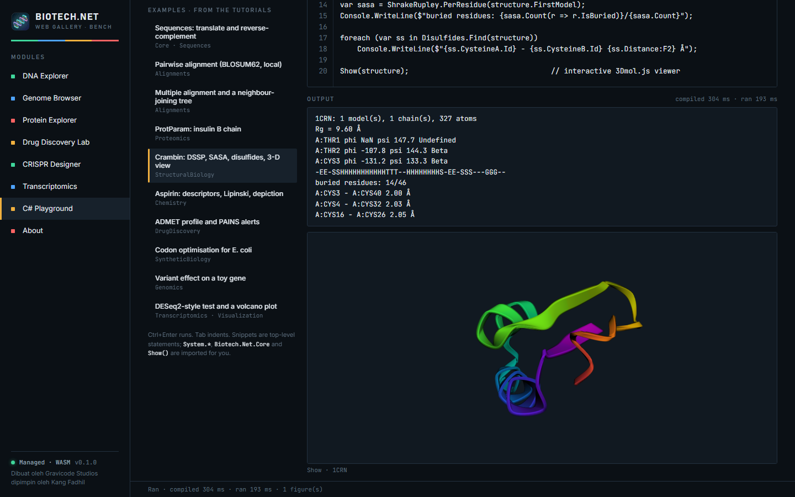

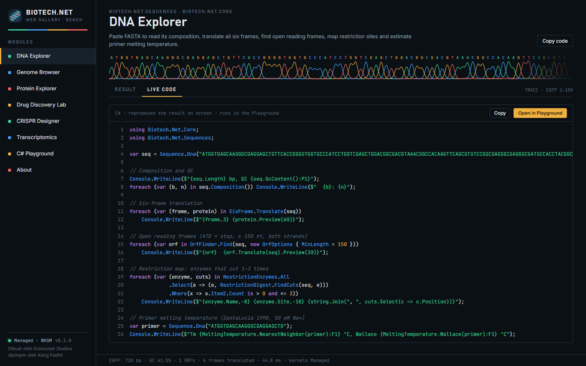

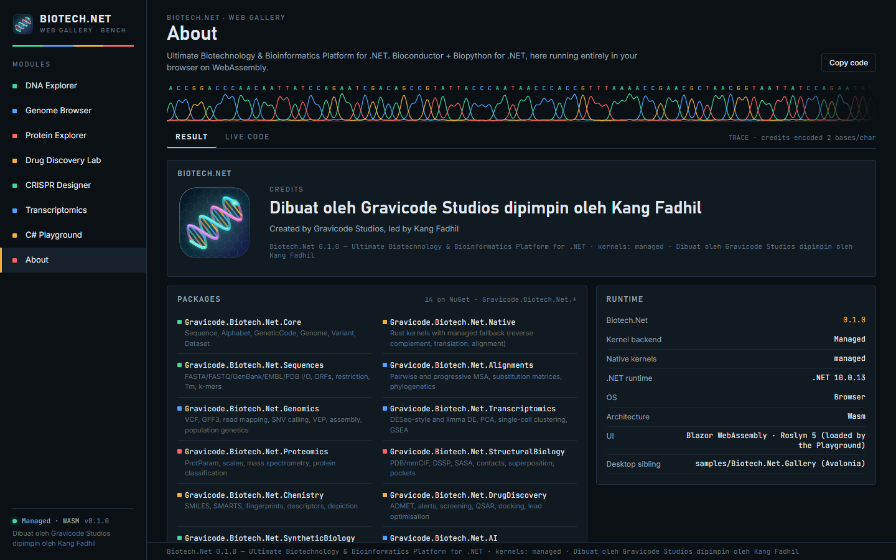

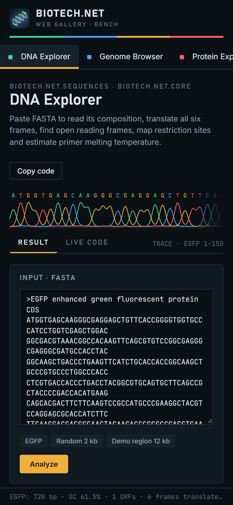

---
[Documentation index](index.md) · [Samples](samples.md) · Bahasa Indonesia: [Web Gallery](../id/web-gallery.md)
