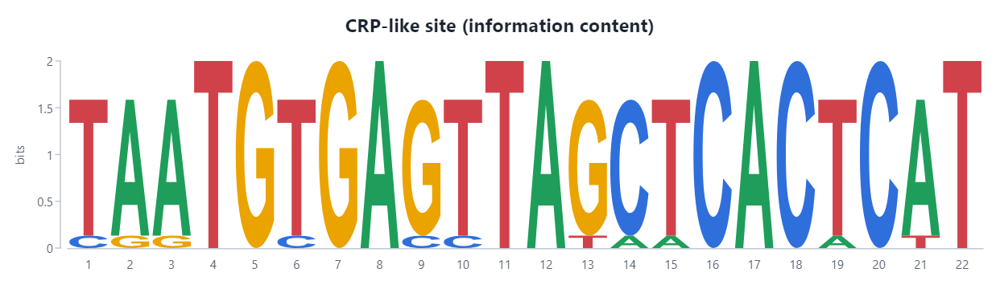

# Tutorial: Sekuens dan I/O berkas

Paket: `Gravicode.Biotech.Net.Sequences` (bergantung pada `Gravicode.Biotech.Net.Core`).

> Dibuat oleh Gravicode Studios dipimpin oleh Kang Fadhil

Tutorial ini membahas tipe inti `Sequence`, pembaca dan penulis FASTA, FASTQ, GenBank, dan EMBL, serta analisis sehari-hari: ORF, motif, digesti restriksi, k-mer, suhu leleh, dan penggunaan kodon.

## 1. Membuat sekuens

`Sequence` menyimpan byte ASCII dan mempertahankan besar-kecil huruf yang Anda berikan. Perbandingan dan kernel mengabaikannya. Komplemen balik, translasi, dan penghitungan basa berjalan di kernel Rust bila pustaka native tersedia, dan di fallback managed bila tidak.

```csharp
using Biotech.Net.Core;

var dna = Sequence.Dna("ATGGCCATTGTAATGGGCCGCTGAAAGGGTGCCCGATAG", id: "demo");
Console.WriteLine(dna.Length);                 // 39
Console.WriteLine(dna.GcContent());            // 0,564...
Console.WriteLine(dna.ReverseComplement());    // CTATCGGGCACCCTTTCAGCGGCCCATTACAATGGCCAT
Console.WriteLine(dna.Transcribe());           // AUGGCCAUUGUAAUGGGCCGCUGAAAGGGUGCCCGAUAG
Console.WriteLine(dna.Translate());            // MAIVMGR*KGAR*
Console.WriteLine(dna.Translate(toStop: true)); // MAIVMGR

// Kode genetik lain: tabel NCBI 1, 2, 4, dan 11
var mito = dna.Translate(GeneticCode.VertebrateMitochondrial);

// Deteksi alfabet dan subsekuens (start berbasis 0, lalu panjang)
var unknown = Sequence.Parse("MKTAYIAKQR");
Console.WriteLine(unknown.Type);               // Protein
var cds = dna.Subsequence(0, 21);
Console.WriteLine(cds.IndexOf("GGG"));         // 14
```

## 2. Membaca dan menulis berkas

Semua pembaca mengalirkan rekaman lewat `IEnumerable<T>`, jadi berkas besar tidak pernah ditahan di memori sekaligus. Berkas berakhiran `.gz` didekompresi otomatis.

```csharp
using Biotech.Net.Core;
using Biotech.Net.Sequences.IO;

string fasta = """
>seq1 first record
ATGCGTACGTTAGC
>seq2 second record
GGGCCCAAATTT
""";
foreach (var record in FastaReader.Parse(fasta))
    Console.WriteLine($"{record.Id}: {record.Length} bp, '{record.Description}'");

// Menulis FASTA (standar 60 kolom) ke TextWriter mana pun
var sw = new StringWriter();
FastaWriter.Write(sw, FastaReader.Parse(fasta));

// FASTQ: offset Phred dideteksi otomatis
string fastq = "@read1\nACGTACGTAC\n+\nIIIIIHHHGG\n";
foreach (var read in FastqReader.Parse(fastq))
{
    Console.WriteLine($"{read.Id} rerata Q{read.MeanQuality():F1}");
    var trimmed = read.TrimByQuality(minQuality: 20);
}

// Akses tanpa peduli format untuk berkas di disk:
//   SequenceFile.Read("genome.gbk")          // GenBank, EMBL, FASTA... dideteksi dari isinya
//   SequenceFile.Write("out.fasta", records)
//   using var fai = IndexedFastaReader.Open("hg38.fa");   // akses acak gaya faidx samtools
//   var region = fai.Fetch("chr1:1,000,001-1,000,500");
```

Rekaman GenBank dan EMBL mempertahankan fitur (`Sequence.Features`) dan field header (`Sequence.Annotations`, kuncinya ada di `RecordKeys`):

```csharp
using Biotech.Net.Core;
using Biotech.Net.Sequences.IO;

var plasmid = Sequence.Dna("ATGAAACGCATTAGCACCACCATTACCACCACCATCACCATTACCACAGGTAACGGTGCGGGCTGA", "pDEMO");
plasmid.Features.Add(new SequenceFeature("CDS", FeatureLocation.Span(0, 66)).With("gene", "demoA"));
string gbk = GenBankWriter.ToString(plasmid);
var roundTrip = GenBankReader.Parse(gbk)[0];
Console.WriteLine(roundTrip.Features[0]);      // CDS 1..66 demoA
```

## 3. Analisis

```csharp
using Biotech.Net.Core;
using Biotech.Net.Sequences;

var genome = RandomSequence.Dna(5_000, seed: 1, gcContent: 0.52, id: "toy");

// Open reading frame pada kedua untai
var orfs = OrfFinder.Find(genome, new OrfOptions { MinLength = 150 });
Console.WriteLine($"{orfs.Count} ORF; terpanjang: {OrfFinder.Longest(genome)}");

// Pencarian motif IUPAC pada kedua untai, bisa dengan toleransi ketidakcocokan
var sites = MotifSearch.FindIupac(genome, "TATAWAWR", bothStrands: true);

// Digesti restriksi dengan tabel enzim bawaan
var digest = RestrictionDigest.Digest(genome, circular: false, "EcoRI", "BamHI", "HindIII");
Console.WriteLine(string.Join(", ", digest.FragmentSizes));

// Profil k-mer (penghitungan padat memakai kernel k-mer)
var kmers = KmerProfile.Count(genome, k: 6);
foreach (var (kmer, count) in kmers.Top(3)) Console.WriteLine($"{kmer} {count}");

// GC dan skew dengan jendela geser
var gc = SlidingWindow.GcContent(genome, window: 500, step: 250);

// Suhu leleh primer (nearest-neighbour, SantaLucia 1998)
var primer = Sequence.Dna("AGCGGATAACAATTTCACACAGG");
Console.WriteLine($"Tm = {MeltingTemperature.NearestNeighbor(primer):F1} °C");

// Penggunaan kodon dan codon adaptation index
var table = CodonUsageTable.FromSequences(orfs.Select(o => o.Extract(genome)));
Console.WriteLine($"CAI ORF pertama: {table.Cai(orfs[0].Extract(genome)):F3}");
```

## 4. Visualisasi

`Biotech.Net.Visualization` menggambar sequence logo dan dot plot. Lihat [tutorial visualisasi](visualization.md).



## Batasan

- Penulisan GenBank/EMBL mencakup baris header umum dan tabel fitur; baris yang jarang dipakai (misalnya `CONTIG`) tidak ditulis kembali.
- `IndexedFastaReader` hanya membaca FASTA biasa, bukan yang terkompresi BGZF. BAM, CRAM, dan tabix tersedia di `Biotech.Net.Genomics` (lihat [tutorial Genomika](genomics.md)).
- `PdbSequenceReader` hanya mengambil sekuens. Untuk koordinat, gunakan `Biotech.Net.StructuralBiology`.

---
Selanjutnya: [Penjajaran](alignments.md) · [Indeks tutorial](index.md)
