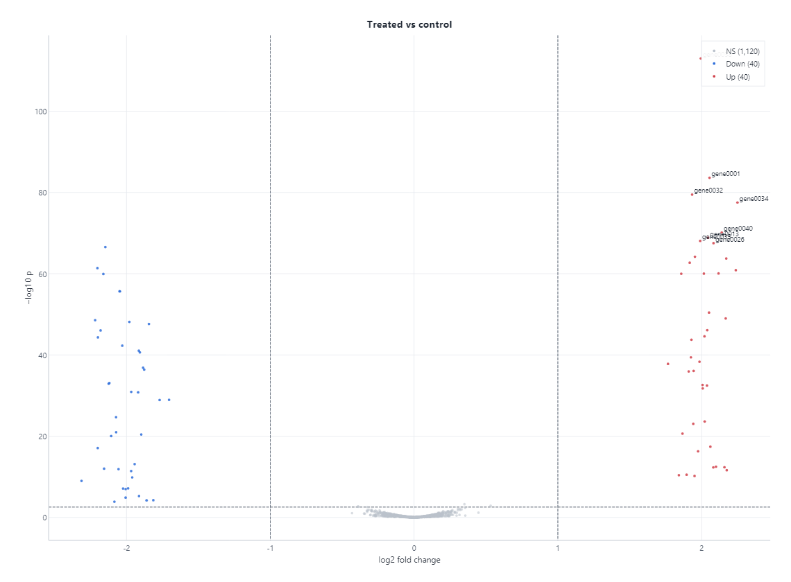

# Tutorial: Transkriptomika

Paket: `Gravicode.Biotech.Net.Transcriptomics`

> Dibuat oleh Gravicode Studios dipimpin oleh Kang Fadhil

RNA-seq bulk (normalisasi, ekspresi diferensial gaya DESeq2 dan limma-voom, VST, PCA), analisis pengayaan (ORA, GSEA preranked), dan analisis sel tunggal (QC, HVG, PCA, graf tetangga, Leiden/Louvain, UMAP, t-SNE, gen penanda).

Matriks hitungan berupa objek `Dataset` (gen di baris, sampel di kolom). Metadata sampel disimpan di `Dataset.ColumnAnnotations`.

## 1. Memuat hitungan

```csharp
using Biotech.Net.Core;
using Biotech.Net.Transcriptomics;

// Dari berkas:
//   CountMatrixReader.ReadFeatureCounts(reader)     keluaran featureCounts (menyimpan panjang gen)
//   CountMatrixReader.ReadHtSeqFiles(paths)         satu berkas HTSeq-count per sampel
//   CountMatrixReader.ReadTable(reader)             tabel gen x sampel apa pun

// Eksperimen sintetis: 1.000 gen, 4 kontrol + 4 perlakuan, 60 perubahan nyata
var rng = new Random(42);
int genes = 1000, samples = 8;
var values = new double[genes * samples];
for (int g = 0; g < genes; g++)
{
    double mean = Math.Exp(2 + rng.NextDouble() * 6);
    double fold = g < 30 ? 4 : g < 60 ? 0.25 : 1;
    for (int s = 0; s < samples; s++)
    {
        double mu = mean * (s >= 4 ? fold : 1);
        values[g * samples + s] = Math.Round(mu * Math.Exp(0.25 * (rng.NextDouble() + rng.NextDouble() + rng.NextDouble() - 1.5)));
    }
}
var counts = new Dataset("counts",
    Enumerable.Range(1, genes).Select(i => $"gene{i:D4}").ToArray(),
    ["ctl1", "ctl2", "ctl3", "ctl4", "trt1", "trt2", "trt3", "trt4"], values);
counts.Annotate("condition", "ctl", "ctl", "ctl", "ctl", "trt", "trt", "trt", "trt");

// Normalisasi
double[] sizeFactors = Normalization.MedianOfRatiosSizeFactors(counts);  // DESeq2
double[] tmm = Normalization.TmmFactors(counts);                          // edgeR
Dataset logCpm = Normalization.LogCpm(counts, normFactors: tmm);
Console.WriteLine(string.Join(", ", sizeFactors.Select(f => f.ToString("F3"))));
```

## 2. Ekspresi diferensial

```csharp
using Biotech.Net.Core;
using Biotech.Net.Transcriptomics;

var rng = new Random(1);
var values = new double[200 * 6];
for (int g = 0; g < 200; g++)
    for (int s = 0; s < 6; s++)
        values[g * 6 + s] = Math.Round(50 * (g < 20 && s >= 3 ? 3 : 1) * (0.8 + 0.4 * rng.NextDouble()));
var counts = new Dataset("counts", Enumerable.Range(0, 200).Select(i => $"g{i}").ToArray(),
    ["a1", "a2", "a3", "b1", "b2", "b3"], values);
counts.Annotate("group", "A", "A", "A", "B", "B", "B");

// Gaya DESeq2: GLM binomial negatif, penyusutan dispersi, uji Wald, koreksi BH
DifferentialExpressionResult deseq = DESeq.Run(counts, "group", "A", "B");
var (up, down) = deseq.CountSignificant(alpha: 0.05);
Console.WriteLine($"DESeq: {up} naik, {down} turun");
foreach (var row in deseq.Top(3))
    Console.WriteLine($"{row.Gene}  log2FC {row.Log2FoldChange:F2}  padj {row.PAdj:E2}");

// Gaya limma-voom
var design = DesignMatrix.FromAnnotations(counts, "group", "A");
DifferentialExpressionResult voom = Limma.VoomTest(counts, design);

// Nilai terstabilkan ragam dan PCA untuk plot QC
Dataset vst = Transforms.Vst(counts);
PcaResult pca = Pca.Fit(DenseMatrix.FromDataset(vst, transpose: true), components: 2);
Console.WriteLine($"PC1 menjelaskan {pca.ExplainedVarianceRatio[0]:P1}");

// Ekspor tabel hasil
var tsv = new StringWriter();
deseq.WriteTsv(tsv);
```


### DESeq2 lebih dalam: desain, kontras, LRT, dan penyusutan

`DESeq` adalah port langkah demi langkah dari DESeq2 1.52: size factor (`Ratio` atau `PosCounts`), dispersi per gen
dengan pencarian garis Cox–Reid milik DESeq2, tren parametrik / lokal / mean, ragam prior dispersi (termasuk simulasi
ber-seed milik DESeq2 bila derajat bebas sisa 3 atau kurang), penyusutan MAP dengan pencilan dispersi, GLM IRLS
ber-ridge, uji Wald atau uji rasio kemungkinan (LRT), penyaringan jarak Cook dan penggantian pencilan
(`MinReplicatesForReplace`, bawaan 7), serta penyaringan independen berdasarkan rerata hitungan ternormalisasi.
`LfcShrink` menambahkan apeglm (prior Cauchy, MAP, SD posterior Laplace, s-value) dan prior normal asli DESeq2.

```csharp
using Biotech.Net.Core;
using Biotech.Net.Transcriptomics;

// 500 gen, 4 sampel kontrol + 4 sampel perlakuan dalam dua batch; gen 0-39 berubah 3 kali lipat.
var rng = new Random(7);
int genes = 500;
var values = new double[genes * 8];
for (int g = 0; g < genes; g++)
{
    double mean = Math.Exp(3 + 5 * rng.NextDouble());
    for (int s = 0; s < 8; s++)
    {
        double mu = mean * (g < 40 && s >= 4 ? 3 : 1) * (s % 4 >= 2 ? 1.3 : 1);
        double gamma = -Math.Log(rng.NextDouble()) * 0.1 + 0.9;            // derau ekstra-Poisson ringan
        values[g * 8 + s] = Math.Round(mu * gamma);
    }
}
var counts = new Dataset("counts", Enumerable.Range(0, genes).Select(i => $"g{i}").ToArray(),
    ["c1", "c2", "c3", "c4", "t1", "t2", "t3", "t4"], values);
counts.Annotate("condition", "ctl", "ctl", "ctl", "ctl", "trt", "trt", "trt", "trt");
counts.Annotate("batch", "b1", "b1", "b2", "b2", "b1", "b1", "b2", "b2");

// ~ batch + condition
var design = DesignMatrix.FromAnnotations(counts, "condition", "ctl", "batch");
DESeqFit fit = DESeq.Fit(counts, design);
Console.WriteLine(string.Join(", ", design.CoefficientNames));   // Intercept, batch_b2, condition_trt_vs_ctl
Console.WriteLine($"trend {fit.TrendType}: {fit.Trend.AsymptoticDispersion:F4} + {fit.Trend.ExtraPoisson:F3}/mean, prior var {fit.DispersionPriorVariance:F3}");

DifferentialExpressionResult res = fit.Results("condition_trt_vs_ctl");     // uji Wald untuk satu koefisien
DifferentialExpressionResult flipped = fit.Results("condition", "ctl", "trt"); // kontras antar-level (tanda dibalik)
DifferentialExpressionResult custom = fit.Results([0, 1, -1]);               // kontras numerik c'β
Console.WriteLine(res);

// Uji rasio kemungkinan untuk efek condition: penuh ~ batch + condition vs tereduksi ~ batch
var reduced = DesignMatrix.FromAnnotations(counts, "batch", "b1");
DifferentialExpressionResult lrt = DESeq.FitLrt(counts, design, reduced).Results();
Console.WriteLine($"LRT: {lrt.CountSignificant(0.1)}");

// Penyusutan fold change untuk pemeringkatan dan plot
LfcShrinkResult ape = LfcShrink.Apeglm(fit, "condition_trt_vs_ctl");
LfcShrinkResult normal = LfcShrink.Normal(fit, "condition_trt_vs_ctl");
Console.WriteLine($"apeglm prior scale {ape.PriorScale:F3}; g0 MLE {res.Log2FoldChange[0]:F3}, apeglm {ape.Table.Log2FoldChange[0]:F3} " +
                  $"(s-value {ape.SValue![0]:E1}), normal {normal.Table.Log2FoldChange[0]:F3}");

// Opsi mengikuti argumen DESeq() / results()
var options = new DESeqOptions
{
    SizeFactorType = SizeFactorType.PosCounts,   // sfType = "poscounts"
    FitType = DispersionFitType.Local,           // fitType = "local"
    MinReplicatesForReplace = 7,                 // penggantian pencilan Cook (bawaan 7)
    CooksFiltering = true,                       // cooksCutoff (bawaan qf(0.99, p, m - p))
    IndependentFiltering = true, Alpha = 0.05,   // independentFiltering, alpha
};
var res2 = DESeq.Fit(counts, design, options).Results(options: options);
Console.WriteLine(res2);
_ = flipped; _ = custom;
```

**Kesetaraan dengan R.** Rangkaian uji membandingkan setiap tahap dengan R 4.6.1 / DESeq2 1.52.0 / apeglm 1.34.0 pada
data publik `pasilla` (7 sampel) dan `airway` (8 sampel). Langkah berbentuk tertutup sama hingga ~1e-12 relatif.
Langkah iteratif (pencarian garis dispersi, IRLS, L-BFGS apeglm) sama hingga 1e-6 relatif untuk sedikitnya 99% gen dan
hingga 1e-3 untuk sisanya: pencarian garis DESeq2 berhenti saat kenaikan log-posterior di bawah 1e-6, dan pada posterior
datar gen berhitungan tinggi, perbedaan bit terakhir antara aritmetika R dan .NET menggeser titik berhenti itu. Pada data
pasilla lengkap (14.599 gen, `~ condition`) selisih relatif terbesar adalah 7,8e-6 untuk dispersi, 1,1e-5 untuk p-value
dan padj, sedangkan ambang penyaringan independen, himpunan gen tersaring, dan pencilan Cook identik. Gen yang IRLS-nya
tidak konvergen (5 dari 12.359 gen yang diuji untuk `~ type + condition`) di-fit ulang oleh R dengan `optim(L-BFGS-B)`
dan di sini dengan metode Newton terproyeksi; fold change-nya berbeda hingga 2e-4 (log2). Tren `Local` mendekati locfit
(selisih relatif median ~0,5%). Pada data airway lengkap (63.677 gen, `~ cell + dex`, 3 derajat bebas sisa) ragam
prior dispersi hasil simulasi identik dengan R; fold change apeglm sama hingga 1e-5 kecuali untuk 0,25% gen - hitungan
rendah pada dispersi maksimum, tempat posterior datar dan titik berhenti L-BFGS apeglm bergeser hingga 1,4e-4 (log2),
kira-kira sejauh selisih antara dua titik awal apeglm sendiri.

`Biotech.Net.Visualization` mengubah hasil menjadi volcano atau MA plot (`new VolcanoPlot(deseq)`, `new MaPlot(deseq)`):



## 3. Analisis pengayaan

```csharp
using Biotech.Net.Transcriptomics.Enrichment;

var sets = new List<GeneSet>
{
    new("CELL_CYCLE", ["CDK1", "CCNB1", "MKI67", "TOP2A", "BUB1"]),
    new("INTERFERON", ["ISG15", "IFIT1", "MX1", "OAS1", "STAT1"]),
};
var universe = sets.SelectMany(s => s.Genes).Concat(Enumerable.Range(0, 200).Select(i => $"BG{i}")).ToList();
var hits = new[] { "CDK1", "CCNB1", "MKI67", "TOP2A", "BG1", "BG2" };

foreach (var r in OverRepresentation.Test(hits, universe, sets))
    Console.WriteLine($"{r.Set}: irisan {r.Overlap}/{r.SetSize}, p {r.PValue:E2}, padj {r.PAdj:E2}");

// GSEA preranked menerima pemetaan gen -> skor (misalnya log2FC atau statistik Wald)
var ranking = universe.Select((g, i) => (g, score: g.StartsWith("BG") ? (i % 7) - 3.0 : 5.0))
                      .ToDictionary(x => x.g, x => x.score);
var gsea = Gsea.Run(ranking, sets, permutations: 500, minSize: 3);
```

Gene set dapat dibaca dari berkas `.gmt` MSigDB dengan `Gmt.ReadFile(path)`.

## 4. RNA-seq sel tunggal

```csharp
using Biotech.Net.Transcriptomics;
using Biotech.Net.Transcriptomics.SingleCell;

// Dari disk: MatrixMarket.Read10x("filtered_feature_bc_matrix/")
// Di sini: 300 sel, 3 populasi, 100 gen
var rng = new Random(7);
var rows = new List<int>(); var cols = new List<int>(); var vals = new List<float>();
for (int c = 0; c < 300; c++)
    for (int g = 0; g < 100; g++)
    {
        int population = c / 100;
        double rate = (g / 10 == population) ? 8 : 1;   // gen 0-9, 10-19, 20-29 menandai tiap populasi
        int count = (int)Math.Round(rate * rng.NextDouble() * 2);
        if (count > 0) { rows.Add(c); cols.Add(g); vals.Add(count); }
    }
var x = SparseMatrix.FromTriplets(300, 100, rows.ToArray(), cols.ToArray(), vals.ToArray());
var sc = new SingleCellExperiment(x,
    Enumerable.Range(0, 300).Select(i => $"cell{i}").ToArray(),
    Enumerable.Range(0, 100).Select(i => $"GENE{i}").ToArray());

Preprocessing.CalculateQcMetrics(sc);
Preprocessing.FilterGenes(sc, minCells: 3);
Preprocessing.NormalizeTotal(sc);
Preprocessing.Log1p(sc);
int[] hvg = Preprocessing.HighlyVariableGenes(sc, nTopGenes: 50);

sc.Embeddings["X_pca"] = Pca.Fit(Preprocessing.Scale(sc, hvg), components: 10).Scores;
NeighborGraph.Build(sc, nNeighbors: 15);
CommunityDetection.Cluster(sc, resolution: 0.5);          // menyimpan CellLabels["leiden"]
Umap.Fit(sc, new UmapOptions { Seed = 1 });                // menyimpan Embeddings["X_umap"]

var markers = MarkerGenes.Rank(sc, "leiden");
foreach (var (cluster, list) in markers.OrderBy(kv => kv.Key))
    Console.WriteLine($"klaster {cluster}: {string.Join(", ", list.Take(3).Select(m => m.Gene))}");
```

`EmbeddingPlot.FromSingleCell(sc, "X_umap", colorBy: "leiden")` memplot embedding-nya.

## 5. Skala atlas dan h5ad

Berkas AnnData `.h5ad` dibaca dan ditulis dengan kode terkelola murni (PureHDF 2.2.0, tanpa HDF5 native). Pembaca
mengikuti encoding on-disk AnnData (array padat, `csr_matrix`/`csc_matrix`, dataframe dengan kolom kategorikal,
string, integer/boolean/string nullable, `obsm`/`varm`/`obsp`/`varp`, `layers`, `uns` bersarang, `raw`, dan tata
letak `h5sparse` sebelum 0.7). Untuk data yang tidak muat di memori, setiap langkah praproses mengalir di atas blok
baris sebuah `ISparseMatrixSource`: berkas h5ad yang dibuka dalam mode backed, atau penyimpanan `.bnsparse` yang
di-memory-map (`MappedSparseMatrix`). Hasilnya berupa array biasa dan `PcaResult`, sehingga kode graf tetangga,
Leiden/Louvain, UMAP, dan gen penanda yang sudah ada dapat langsung melanjutkan.

```csharp
using Biotech.Net.Transcriptomics;
using Biotech.Net.Transcriptomics.SingleCell;

// Pengganti kecil untuk berkas atlas sungguhan: 3 000 sel x 2 000 gen, ditulis sebagai .h5ad.
var rng = new Random(7);
var rows = new List<int>(); var cols = new List<int>(); var vals = new List<float>();
for (int c = 0; c < 3000; c++)
    for (int g = 0; g < 2000; g++)
    {
        double rate = (g / 20 == c % 5) ? 3.0 : 0.15;     // gen 0-19, 20-39, ... menandai lima populasi
        int count = rng.NextDouble() < rate / (1 + rate) ? 1 + (int)(rng.NextDouble() * rate * 2) : 0;
        if (count > 0) { rows.Add(c); cols.Add(g); vals.Add(count); }
    }
var x = SparseMatrix.FromTriplets(3000, 2000, rows.ToArray(), cols.ToArray(), vals.ToArray());
var cellTable = new AnnDataFrame(Enumerable.Range(0, 3000).Select(i => $"cell{i}").ToArray());
cellTable["sample"] = Categorical.FromLabels(Enumerable.Range(0, 3000).Select(i => i < 1500 ? "A" : "B").ToArray());
var geneTable = new AnnDataFrame(Enumerable.Range(0, 2000).Select(j => j < 5 ? $"MT-{j}" : $"GENE{j}").ToArray());
var adata = new AnnData(AnnMatrix.FromSparse(x), cellTable, geneTable);
adata.Uns["description"] = "synthetic example";
H5ad.Write("atlas.h5ad", adata, new H5adWriteOptions { Compression = H5adCompression.Gzip });

// 1. Baca kembali ke memori (berlaku untuk berkas apa pun yang ditulis anndata) lalu serahkan ke pipeline in-memory.
AnnData loaded = H5ad.Read("atlas.h5ad");
Console.WriteLine(loaded);
SingleCellExperiment small = loaded.ToSingleCellExperiment();

// 2. Mode backed: obs/var di memori, X tetap di disk dan dibaca per irisan.
using var backed = H5ad.OpenBacked("atlas.h5ad");
SparseMatrix firstCells = backed.X!.ReadRows(0, 100);
Console.WriteLine($"{backed}; first 100 cells hold {firstCells.NonZeroCount} counts");

// 3. Out-of-core: salin X ke penyimpanan memory-mapped, lalu alirkan setiap langkah di atasnya.
using var counts = MappedSparseMatrix.Create("atlas.bnsparse", backed.X);
QcMetrics qc = OutOfCore.CalculateQcMetrics(counts, backed.Var.Index);              // prefiks mitokondria "MT-"
HvgResult hvg = OutOfCore.HighlyVariableGenes(counts, nTopGenes: 500, flavor: HvgFlavor.SeuratV3);
using var logNorm = OutOfCore.NormalizeTotalLog1pToLayer(counts, "log1p_norm", cellTotals: qc.TotalCounts);
PcaResult pca = OutOfCorePca.Fit(logNorm, hvg.Selected, components: 30);
Console.WriteLine($"PC1 explains {pca.ExplainedVarianceRatio[0]:P1}; {hvg.Selected.Length} HVG");

// 4. Skor PCA langsung dipakai kode graf, klasterisasi, dan UMAP yang sudah ada.
var graph = NeighborGraph.Build(pca.Scores, nNeighbors: 15);
int[] clusters = CommunityDetection.Cluster(graph.Connectivities, resolution: 0.5);
var umap = Umap.Fit(graph, new UmapOptions { Seed = 1 });
Console.WriteLine($"{clusters.Distinct().Count()} klaster Leiden");

// 5. Tulis hasilnya sebagai .h5ad tanpa memuat matriks: X ter-log-normalisasi, layer hitungan mentah, PCA, UMAP, QC.
qc.WriteTo(backed.Obs, backed.Var);
hvg.WriteTo(backed.Var);
backed.Obs["leiden"] = Categorical.FromLabels(clusters.Select(c => c.ToString()).ToArray());
H5ad.WriteStreaming("atlas_processed.h5ad", logNorm, backed.Obs, backed.Var,
    layers: new Dictionary<string, ISparseMatrixSource> { ["counts"] = counts },
    obsm: new Dictionary<string, AnnMatrix> { ["X_pca"] = AnnMatrix.FromDense(pca.Scores), ["X_umap"] = AnnMatrix.FromDense(umap) },
    options: new H5adWriteOptions { Compression = H5adCompression.Gzip });
```

`OutOfCore.NormalizeTotalLog1p(source, directory)` menulis penyimpanan baru alih-alih layer (pakai ini untuk sumber
h5ad backed); `MappedSparseMatrix.Create` mentransposisi berkas CSC secara out-of-core, karena blok baris matriks
CSC jika tidak demikian memerlukan pemindaian penuh setiap kali.

### Kesetaraan dengan scanpy

Diukur terhadap anndata 0.13.4 / scanpy 1.12.4 / scikit-learn 1.9.1 pada subset 300 sel × 1 000 gen dari 10x
pbmc3k, ditambah berkas sintetis yang mencakup setiap encoding (`tests/Biotech.Net.Transcriptomics.Tests/Fixtures/AnnData`,
generator `make_fixtures.py`):

| Langkah | Kesesuaian |
|---|---|
| Membaca (padat, CSR gzip, CSC, kategorikal, nullable, `uns`, `raw`, legacy) | eksak, dibandingkan dengan nilai yang di-dump oleh numpy |
| Menulis | anndata membaca kembali berkas kita identik dengan sumbernya (`X`, dtype `obs`/`var`, `obsm`, `obsp`, `layers`, `uns`, `raw`) |
| `calculate_qc_metrics` (semua kolom obs/var, `percent_top`) | ≤ 1e-6 relatif (scanpy menjumlah dalam float32) |
| `normalize_total` + `log1p` (target 1e4 dan median) | ≤ 1e-6 relatif, jumlah baris dan kolom serta 200 entri sampel |
| `highly_variable_genes(flavor="seurat_v3")` | means 1e-12, variances 1e-10, `variances_norm` 1e-9; gen dan peringkat sama (nilai seri diurutkan berbeda: argsort numpy tidak stabil) |
| `highly_variable_genes(flavor="seurat")` | means/dispersions 1e-6, `dispersions_norm` 1e-5; gen sama |
| PCA, `OutOfCorePcaSolver.Covariance` | variansi terjelaskan 1e-8 relatif terhadap scikit-learn; loading \|cos\| > 1 − 1e-8; skor 1e-6 (hingga tanda) |
| PCA, `OutOfCorePcaSolver.Randomized` (6 iterasi pangkat, 20 oversample) | variansi PC1–10 dalam 0,1 %, PC1–20 dalam 2 %; PC1–5 \|cos\| > 0,999 |

`Preprocessing.HighlyVariableGenes` kini memakai kode yang sama, sehingga pipeline in-memory mendapat kesetaraan yang sama.

### Memori dan waktu pada satu juta sel

Matriks sintetis 1 000 000 sel × 30 000 gen (sekitar 1 100 gen terdeteksi per sel, 1,11 × 10⁹ entri tersimpan,
8,9 GB di disk) pada laptop (Intel i7-8650U, 4 inti / 8 thread, RAM 16 GB, SSD lokal), build Release, dibuat dan
dijalankan dengan `dotnet run -c Release -p:SkipRustBuild=true -- --atlas` di `benchmarks/Biotech.Net.Benchmarks`:

| Langkah (penyimpanan memory-mapped) | Waktu | Puncak memori privat |
|---|---|---|
| Metrik QC (1 lintasan) | 34 dtk | 0,64 GB |
| HVG Seurat v3, 2 000 gen (2 lintasan) | 54 dtk | 0,82 GB |
| `normalize_total` + `log1p` ditulis sebagai layer baru (4,4 GB) | 71 dtk | 0,39 GB |
| PCA, solver kovarians, 2 000 HVG, 50 PC (2 lintasan) | 102 dtk | 2,8 GB (0,4 GB di antaranya skor 1 jt × 50) |
| Ekspor h5ad gzip secara streaming untuk 200 000 sel (berkas 0,45 GB) | 18 dtk | 1,8 GB |
| QC dari h5ad tersebut dalam mode backed | 36 dtk | 2,1 GB |

Memori privat tetap sama dari 100 000 hingga 1 000 000 sel (0,63 vs 0,64 GB untuk QC): dibatasi oleh ukuran blok
(≤ 2 jt entri per blok, beberapa blok sekaligus) ditambah array hasil O(sel + gen), dan untuk PCA matriks kovarians
gen² serta skor sel × komponen. Puncak memori privat mencakup sampah yang belum dikumpulkan GC; heap hidup yang
diukur setelah koleksi paksa selama ekspor h5ad adalah 0,09 GB. Working set tumbuh hingga 12 GB karena OS
mempertahankan halaman berkas yang dipetakan; halaman itu adalah cache berkas bersih yang diambil kembali saat
memori menipis, bukan alokasi proses.

### Batasan pada skala atlas

- Graf tetangga masih brute force eksak: 49 dtk untuk 50 000 sel, jadi kira-kira berjam-jam untuk sejuta sel.
  Bangun graf pada subsampel atau pada skor PCA dari sebagian sel; indeks tetangga terdekat aproksimasi belum
  diimplementasikan. t-SNE juga masih eksak O(n²).
- Gen penanda, `Scale`, dan `Pca` padat in-memory memerlukan `SingleCellExperiment` di memori.
- PureHDF tidak dapat memodifikasi berkas HDF5 yang sudah ada, sehingga layer baru masuk ke penyimpanan `.bnsparse`
  atau ke h5ad baru yang ditulis `H5ad.WriteStreaming`; tidak ada penambahan langsung ke h5ad.
- Pembacaan backed lewat PureHDF sekitar 3–4× lebih lambat daripada penyimpanan memory-mapped (dekompresi gzip dan
  pembukuan hyperslab); konversi sekali dengan `MappedSparseMatrix.Create` bila butuh beberapa lintasan.
- Nilai sparse disimpan float32 di memori (elemen sparse float64 menyimpan salinan eksak hanya untuk round-trip);
  matriks padat float64. Awkward array, array compound/record (`rank_genes_groups` versi lama), tata letak `obs`/`var`
  compound sebelum 0.7, zarr, dan penulisan float16 tidak didukung; entri `uns` yang tidak didukung dibaca sebagai
  placeholder `AnnUnsupported` dan dilewati saat menulis.
- Level gzip dibatasi 1 dan 9 oleh PureHDF; filter LZF dan Blosc tidak didukung.

## Batasan

- `DESeq` mereproduksi DESeq2 1.52 (lihat "Kesetaraan dengan R" di atas) tetapi belum mendukung bobot observasi, matriks faktor normalisasi, `betaPrior = TRUE`, backend glmGamPoi, atau kontras level yang memperhitungkan interaksi; `LfcShrink` menyediakan apeglm dan prior normal, bukan ashr.
- Pipeline sel tunggal in-memory menyimpan matriks sebagai `SparseMatrix` CSR; untuk data lebih besar gunakan langkah out-of-core dan I/O h5ad di bagian 5, yang memiliki daftar batasannya sendiri.
- Graf tetangga dicari secara brute force eksak (O(n²)), dan t-SNE memakai metode eksak O(n²) (Barnes–Hut belum ada). Keduanya ditujukan untuk hingga puluhan ribu sel, bukan jutaan.

---
Sebelumnya: [Genomika](genomics.md) · Selanjutnya: [Proteomika](proteomics.md) · [Indeks tutorial](index.md)
